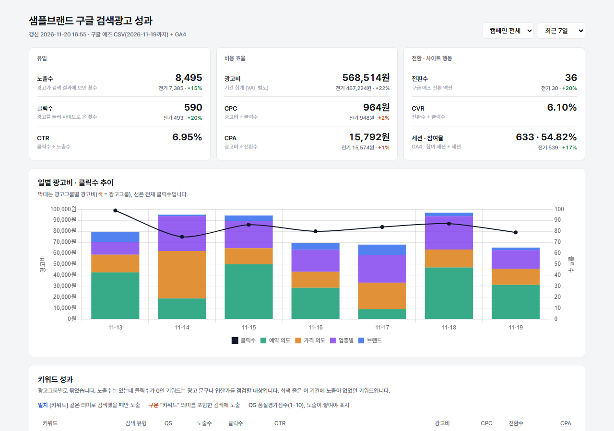
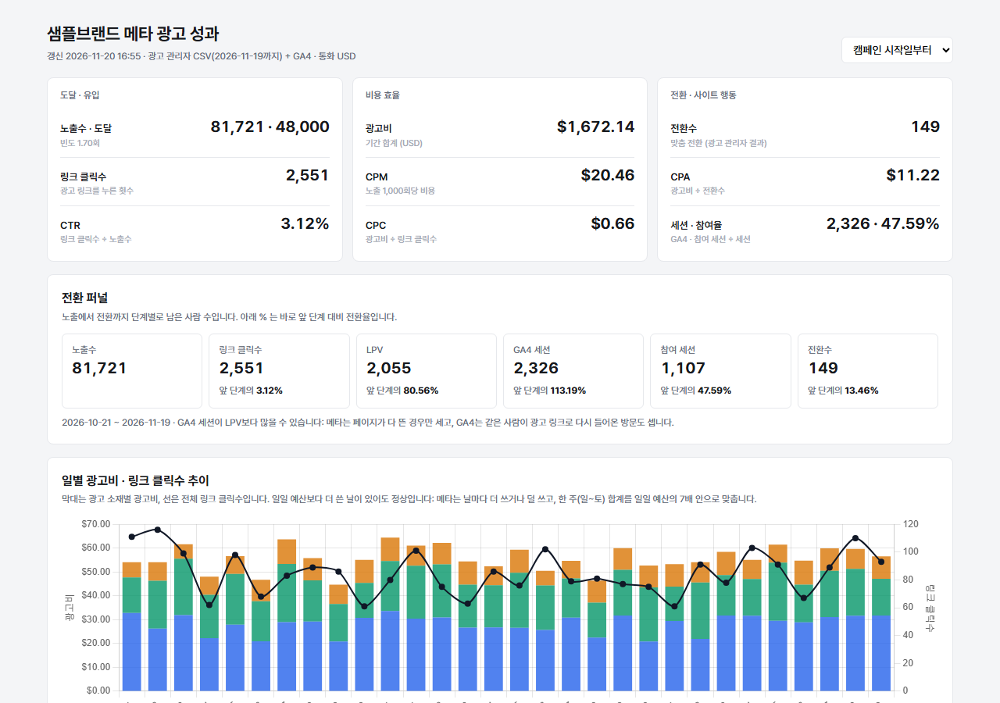
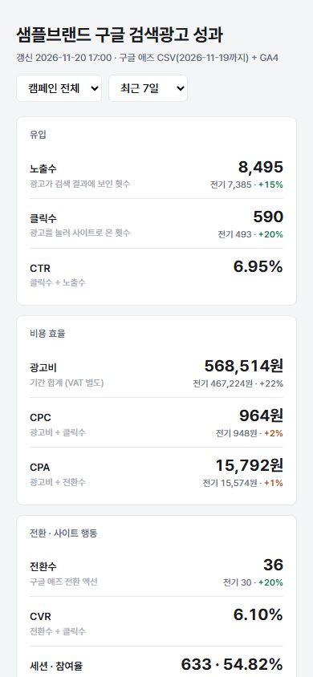
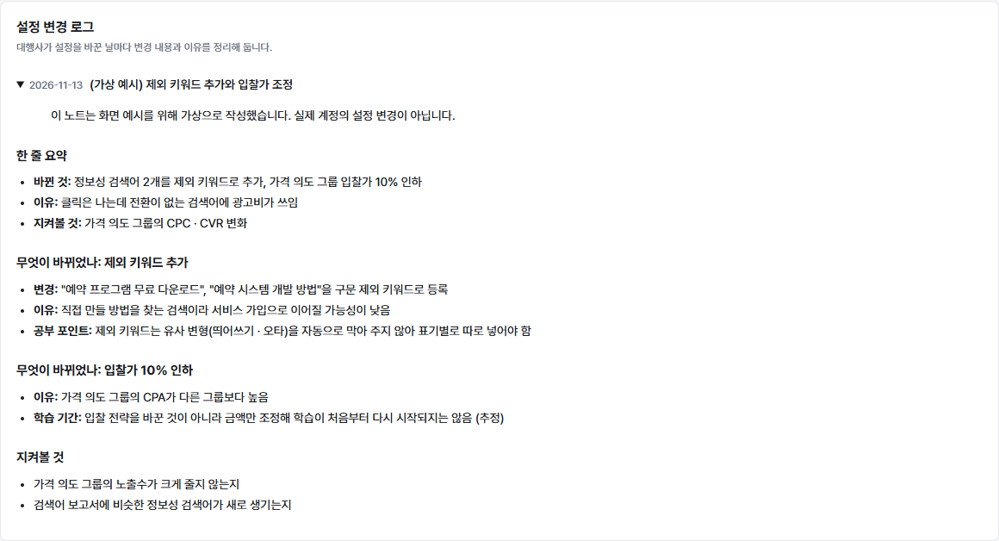
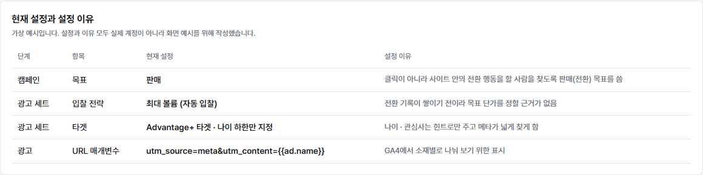

# 광고 성과 대시보드 (구글 검색광고 · 메타 광고)

구글 애즈, 메타 광고 관리자, GA4에 흩어진 광고 숫자를 매일 아침 한 화면에 모아 보는 로컬 대시보드입니다.
서버 없이 HTML 파일 한 장으로 열립니다.



> 화면의 숫자와 브랜드는 전부 샘플(난수)입니다. 실제 계정 성과가 아닙니다.

## 만든 이유

광고 운영은 외부 대행사가 맡고 저는 성과를 확인해 팀에 보고하는 역할이었습니다. 매일 반복되는 불편이 세 가지 있었습니다.

- **숫자가 세 곳에 나뉘어 있음**: 노출·클릭·광고비는 구글 애즈와 메타 광고 관리자에, 광고를 누른 뒤 사이트에서 한 행동은 GA4에 있습니다. 매일 세 화면에 들어가 기간을 맞추고 내려받아야 했습니다.
- **광고비를 쓴 다음이 안 보임**: 매체 화면은 클릭까지만 보여줍니다. 어떤 키워드·소재로 들어온 사람이 사이트에 머물렀는지 보려면 GA4와 손으로 맞춰야 했습니다.
- **계정에 흔적을 남기면 안 됨**: 애즈 화면에서 열이나 보고서 설정을 바꾸면 변경 내역에 제 이름이 남아 대행사 작업 기록과 섞입니다.

여기에 하나 더, 대행사가 설정을 바꿀 때마다 왜 바꿨는지 이해하고 싶었습니다. 그래서 숫자를 모으는 일과 설정 변경을 해설하는 일을 함께 자동화했습니다.

## 화면에서 보는 것

| 영역 | 답하려는 질문 |
|---|---|
| KPI 3묶음 (유입 · 비용 효율 · 전환) | 이번 기간이 바로 앞 기간보다 나아졌나? CPC · CPA처럼 낮을수록 좋은 지표는 내려갈 때 초록으로 표시 |
| 일별 광고비 · 클릭수 추이 | 어느 광고그룹(소재)이 예산을 가져갔고, 클릭은 따라왔나? |
| 키워드 성과 (구글) | 노출은 있는데 클릭이 0인 키워드는? 품질평가점수는 몇인가? |
| 검색어 보고서 (구글) | 사람들이 실제로 무엇을 검색했나? 제외 키워드 후보는? |
| 광고 소재 성과 | 소재별 CTR · CPC · CPA 차이, 메타 품질 순위 |
| 사이트 행동 (GA4) | 광고그룹 · 검색어 · 소재별로 들어온 사람의 참여율과 체류 시간 |
| 전환 퍼널 (메타) | 노출, 링크 클릭, LPV, 세션, 참여 세션, 전환 중 어디서 가장 많이 빠지나? |
| 설정 변경 로그 (구글) | 대행사가 바꾼 설정과 그 이유 (공식 도움말 근거) |
| 현재 설정과 설정 이유 (메타) | 목표 · 입찰 · 타겟 · 게재 위치를 왜 이렇게 잡았나? |
| 용어 풀이 | CTR · CPC · CPA · QS · LPV 등 화면에 나오는 지표 정의 |

| 메타 광고 | 모바일 (390px) |
|---|---|
|  |  |

## 공부 자료도 함께 받기

숫자만 보여주면 "왜 이렇게 설정했는지"는 여전히 모릅니다. 그래서 대시보드가 매일 갱신될 때 공부 자료도 같이 만들어지게 했습니다.

- **설정 변경 로그 (구글)**: 매일 받는 변경 내역 CSV에서 새 변경을 찾으면 `insights.py`가 Claude CLI에 웹 검색을 허용해 해설 노트를 씁니다. 노트에는 무엇이 바뀌었는지, 왜 바꿨을지(구글 공식 도움말 · 업계 글 링크), 학습 기간이 다시 시작되는지, 앞으로 며칠 볼 숫자가 들어갑니다. 새 변경이 없는 날은 호출하지 않습니다.
- **현재 설정과 설정 이유 (메타)**: 광고 관리자 설정 내보내기 파일을 `read_settings.py`가 읽어 목표 · 입찰 · 타겟 · 게재 위치를 표로 옮기고 메타 권장 방식에 비춰 왜 그렇게 잡았는지 한 줄씩 붙입니다. 지난 파일과 달라진 항목은 따로 기록합니다.

| 설정 변경 로그 (구글) | 현재 설정과 설정 이유 (메타) |
|---|---|
|  |  |

> 이 저장소의 노트와 설정 이유는 화면 예시를 위해 **가상으로 작성한 내용**입니다. 실제 광고 계정의 설정 변경이나 대행사의 판단이 아닙니다.

## 동작 방식

```
매일 09:00 Windows 작업 스케줄러
  └ fetch_csv.ps1 / fetch_meta.ps1
      ├ 브라우저 에이전트가 '어제' 기준 보고서 CSV만 내려받음 (읽기 전용, 저장 · 수정 금지 지시)
      ├ 내려받은 CSV를 data/csv/YYYY-MM-DD/ 로 정리
      ├ insights.py: 구글 변경 내역 CSV에 새 변경이 있으면 Claude CLI가 해설 노트 작성 (없으면 호출 안 함)
      └ ads_dashboard.py / meta_dashboard.py
          ├ 매체 CSV  → 노출수 · 클릭수 · 광고비 · 전환수
          ├ GA4 API   → 세션 · 참여 · 주요 이벤트 (최근 60일을 매번 다시 받아 늦게 잡힌 전환까지 반영)
          └ template.html + 공통 CSS · JS → dashboard.html 한 장
```

## 설계에서 신경 쓴 점

- **광고 계정에 흔적을 남기지 않음**: 구글 애즈 API로 접속하지 않습니다. 애즈와 연결된 GA4 데이터와 화면의 '내보내기'만 씁니다.
- **같은 지표는 한 출처에서만**: 노출수 · 클릭수 · 광고비 · 전환수는 매체 CSV, 세션 · 참여는 GA4에서 가져옵니다. 두 출처를 섞어 더하지 않습니다.
- **한쪽이 실패해도 화면은 뜸**: GA4가 막히면 CSV만으로, CSV가 비면 GA4만으로 그립니다. 수집 실패는 로그 파일에 남깁니다.
- **회사 정보는 코드 밖에**: GA4 속성 번호, 광고 계정 번호, 캠페인 이름 규칙, 키 파일 경로는 `config.json`에만 둡니다. 이 파일은 저장소에 올리지 않고 생성된 HTML에도 키 경로나 계정 번호를 넣지 않습니다.
- **파일 한 장으로 공유**: 두 대시보드가 같이 쓰는 CSS · JS(`adkit.css`, `adkit.js`)를 빌드할 때 HTML 안에 끼워 넣습니다. 받는 사람은 더블클릭만 하면 됩니다.

## 폴더 구조

```
AdsDashboard/               구글 검색광고
  adkit.py / .css / .js     두 대시보드 공통 도구 (설정, GA4 호출, HTML 조립, 차트·표 함수)
  ads_dashboard.py          애즈 CSV + GA4 → dashboard.html
  insights.py               변경 내역 → 설정 변경 해설 노트 (Claude CLI)
  fetch_csv.ps1             매일 CSV 수집 · 정리 · 빌드
  make_sample.py            데모용 가짜 데이터 생성
  config.example.json       설정 예시 (복사해서 config.json으로)
MetaAdsDashboard/           메타 광고
  meta_dashboard.py         광고 관리자 CSV + GA4 → dashboard.html
  read_settings.py          설정 내보내기 → '현재 설정과 설정 이유' 표
  fetch_meta.ps1            매일 CSV 수집 · 정리 · 빌드
```

## 실행해 보기

키나 광고 계정 없이 샘플 데이터로 화면을 볼 수 있습니다.

```bash
pip install -r requirements.txt
cd AdsDashboard
python make_sample.py                  # sample/ 에 가짜 데이터 생성
python ads_dashboard.py --demo --open  # 구글 대시보드
cd ../MetaAdsDashboard
python meta_dashboard.py --demo --open # 메타 대시보드
```

실제 계정에 연결하려면:

1. `AdsDashboard/config.example.json`을 `config.json`으로 복사해 GA4 속성 번호, 캠페인 필터, 광고그룹 · 소재 표시명을 채웁니다.
2. GA4 속성에 서비스 계정을 '뷰어'로 추가하고 키 파일 경로를 `ga4_key_file`에 적습니다.
3. `python ads_dashboard.py --open`으로 실행합니다. 매일 자동으로 돌리려면 `fetch_csv.ps1`을 작업 스케줄러에 등록합니다.

## 보안

- `config.json`, 키 파일, `data/`, `logs/`, 생성된 `dashboard.html`은 `.gitignore`에 들어 있습니다.
- 공개 저장소의 코드는 회사 이름 · 계정 번호 · 내부 주소 · 개인 경로가 남아 있지 않은지 검사한 뒤 올렸습니다.
- 샘플 데이터는 난수로 만든 것입니다.

## 한계

- GA4의 `sessionGoogleAdsKeyword`는 광고비 지표와 함께 조회할 수 없어서 키워드 단위 비용은 애즈 CSV에 의존합니다.
- 애즈 비용이 GA4에 들어오기까지 하루 정도 걸립니다. 그래서 대시보드는 어제까지를 완성본으로 봅니다.
- CSV 수집은 브라우저 에이전트가 하므로 매체 로그인이 풀리면 그날 수집이 빠집니다. 로그와 `data/csv/날짜/` 파일 수로 확인합니다.

## 앞으로 할 일

- **서버에 올리기**: 지금은 제 PC의 작업 스케줄러가 매일 수집하고 결과는 HTML 파일을 직접 열어 봅니다. 그래서 PC가 꺼져 있으면 그날 수집이 빠집니다. 추후 서버에 올려 PC와 상관없이 매일 돌게 하고 팀원이 주소로 접속해 볼 수 있게 할 예정입니다.

## 사용 기술

Python 3.12 · GA4 Data API (`google-analytics-data`) · Chart.js 4 · marked · Playwright (스크린샷) · PowerShell · Windows 작업 스케줄러 · Claude Code CLI
